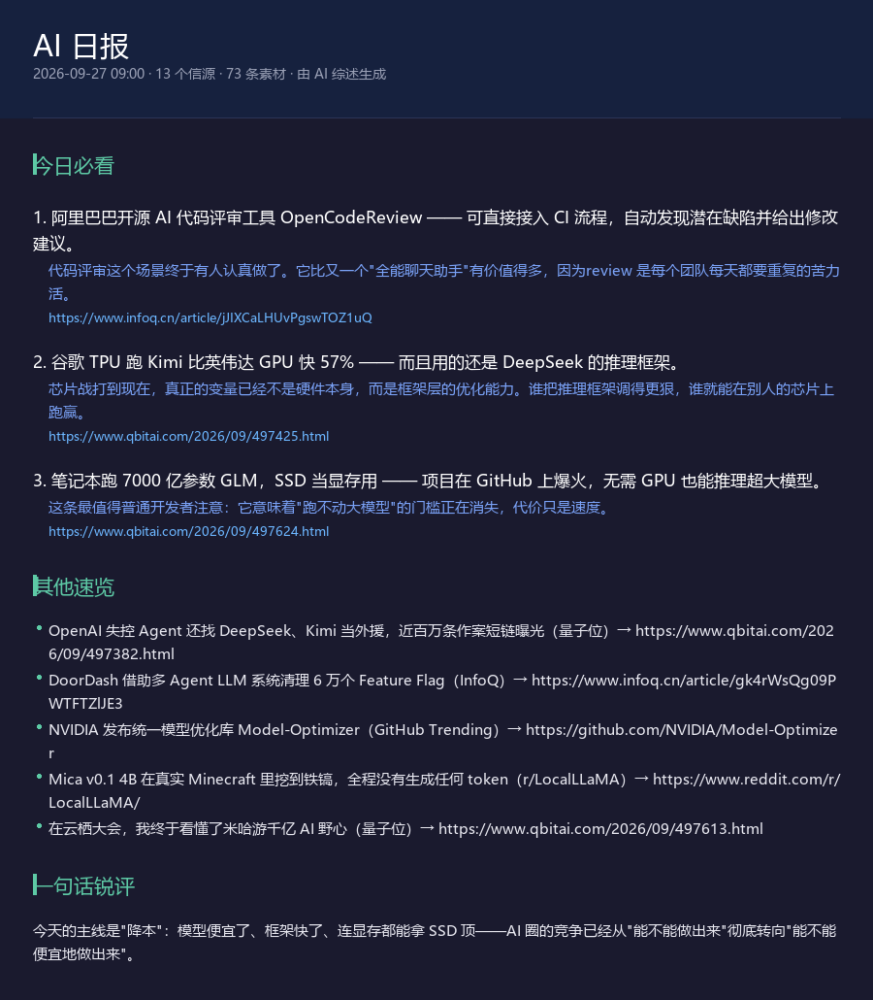
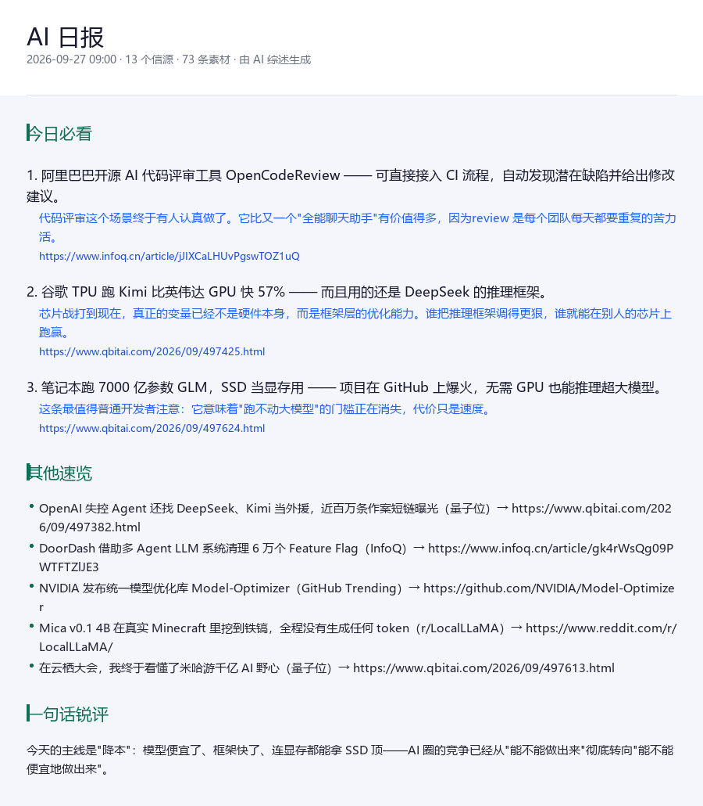

# AI 日报 · 多源综述（astrbot_plugin_ai_daily）

> 聚合 14 个一手信源，让大模型**从零写**一份中文 AI 日报，定时推送到群 / 私聊，并支持对日报内容继续追问。



<details>
<summary>点击查看浅色主题</summary>



</details>

## 和同类插件的区别

市面上「AI 日报」类插件大多是这样工作的：

```
订阅某个第三方 AI 日报（如橘鸦）→ 让模型压缩成几条 → 推送
```

也就是**别人生产、模型精炼**。所有人蹭同一口井，所以推出来的内容高度雷同。

本插件换掉了上游：

```
自己并发采集 14 个一手信源 → 去重合并 → 让模型通读后从零综述成一份日报
```

**原料自己采、日报自己写**，内容不依赖任何单一第三方。这是本插件和同类最本质的差别。

## 信源（零 Key，开箱即用）

| 分组 | 信源 | 类型 |
|---|---|---|
| 官方发布 | OpenAI / Google AI / HuggingFace Blog / DeepMind | RSS |
| 论文研究 | HuggingFace 每日论文 / arXiv cs.AI / Google Research | JSON / RSS |
| 技术社区 | Hacker News / r/LocalLLaMA / GitHub Trending | RSS / HTML |
| 中文媒体 | 量子位 / InfoQ | RSS |
| 英文媒体 | TechCrunch AI / NVIDIA Blog | RSS |

共 14 个，全部公开接口、无需 API Key。

- Hacker News 与 GitHub Trending 是泛技术源，插件会**自动按 AI 关键词前置过滤**，只保留 AI 相关内容。
- 周末 arXiv 不发布新预印本，该源当天为空属正常。
- 单个信源失败或超时不影响其他源，只是该源本次无内容。

## 功能

- **定时推送** — 每天到点自动生成并推送到已订阅会话，重启不丢
- **手动获取** — `/日报` 随时生成一份
- **追问** — `/日报追问 那个 GLM 跑在笔记本上是怎么回事`，模型带着当天全部素材回答
- **信源可配** — 按会话开关单个信源
- **三种综述风格** — 简洁简报 / 深度解读 / 轻松吐槽
- **跨源去重** — 标题归一化后合并同一事件的多方报道，保留信息量最大的一条
- **防凑数** — 提示词明确要求淘汰营销稿与无关内容，"宁可少写，不要凑数"
- **失败兜底** — 模型调用失败时自动回退为素材条目列表，不会什么都不发
- **卡片 / 纯文本** — 可切换；渲染失败自动回退文本
- **静默时段** — 夜间不打扰，可选出静默后补发

## 指令

| 指令 | 说明 | 权限 |
|---|---|---|
| `/日报` | 立即生成并推送今日日报 | 所有人 |
| `/日报订阅` | 本会话开启每天自动推送 | 所有人 |
| `/日报退订` | 关闭本会话自动推送 | 所有人 |
| `/日报追问 <问题>` | 就今日日报的内容继续追问 | 所有人 |
| `/日报源` | 查看全部信源开关状态 | 所有人 |
| `/日报源 开启 <信源>` | 开启某个信源 | 管理员 |
| `/日报源 关闭 <信源>` | 关闭某个信源（至少保留 1 个） | 管理员 |
| `/日报时间 08:30` | 设置本会话推送时间 | 管理员 |
| `/日报风格 deep` | 切换风格：`brief` / `deep` / `humor` | 所有人 |
| `/日报状态` | 查看当前配置与最近推送 | 所有人 |
| `/日报帮助` | 显示完整说明 | 所有人 |

信源名支持 key、中文名或模糊匹配，例如 `/日报源 关闭 量子位`、`/日报源 开启 hn` 都可以。

`/日报` 支持简写分发：`/日报 订阅`、`/日报 源 关闭 hn`、`/日报 时间 08:30` 等价于对应的独立指令。

## 配置

在 AstrBot 管理面板的插件配置页修改，共 17 项：

| 配置项 | 默认 | 说明 |
|---|---|---|
| `enabled_sources` | 8 个源 | 新会话默认启用的信源 |
| `push_time` | `09:00` | 默认每日推送时间 |
| `lookback_hours` | `36` | 只收录最近多少小时内发布的内容 |
| `per_source_n` | `12` | 每个信源抓取条数 |
| `max_candidates` | `60` | 送给模型的最大候选条数 |
| `must_see_n` | `3` | 「今日必看」条数 |
| `brief_n` | `6` | 「其他速览」条数（0 = 不输出该板块） |
| `style` | `brief` | 综述风格 |
| `llm_provider_id` | 空 | 指定模型商；留空用会话当前模型 |
| `render_image` | `true` | 卡片 / 纯文本（见下方提示） |
| `theme` | `dark` | 卡片主题 dark / light |
| `quiet_hours` | 空 | 静默时段，如 `23:00-07:00` |
| `quiet_catchup` | `true` | 静默结束后补发 |
| `fetch_timeout` | `15` | 单源抓取超时（秒） |
| `retry_times` | `2` | 抓取失败重试次数 |
| `max_retry_llm` | `1` | 模型调用失败重试次数 |
| `max_subs` | `50` | 最大订阅会话数 |

> **关于 `render_image`**：图片卡片观感更好，但**图片里的链接无法点击**。新闻日报的价值在于「顺着链接去看原文」，所以如果你更看重链接可点，把这一项关掉走纯文本。

## 安装

1. 把 `astrbot_plugin_ai_daily` 目录放进 AstrBot 的 `data/plugins/` 下
2. 安装依赖：`pip install -r requirements.txt`（aiohttp、Pillow）
3. 重启 AstrBot，在插件管理中启用
4. 确保已配置至少一个模型商（日报综述依赖 LLM）

## 常见问题

**Q：提示「所有信源都没有抓到符合时间窗口的内容」？**
A：调大「内容时间窗口」（`lookback_hours`）到 72 小时试试；周末部分源（arXiv、各家博客）本身就不更新。

**Q：日报里没看到某类内容？**
A：检查 `/日报源` 里该信源是否开启。默认只启用 8 个源，论文类（arXiv / Google Research）默认关闭，可按需开启。

**Q：想固定用某个便宜的小模型生成日报？**
A：把「指定模型商」`llm_provider_id` 填上对应模型商 ID 即可，不再跟随会话模型。

**Q：卡片文字变成方块？**
A：系统缺少中文字体。Windows 自带微软雅黑，一般不会；Linux 可安装 `fonts-wqy-zenhei` 或 `fonts-noto-cjk`。

**Q：会不会很费 token？**
A：默认把 60 条素材拼进提示词，约 1.7 万字。可下调 `max_candidates` 与 `per_source_n` 控制成本。

## 开发

```bash
# 离线冒烟测试（stub 掉 AstrBot，不联网，覆盖指令/推送/持久化/渲染，126 项断言）
python _selftest.py

# 端到端演练（真实联网抓取 + 真实拼装提示词 + 真实渲染卡片）
python _e2e.py
```

## License

MIT
